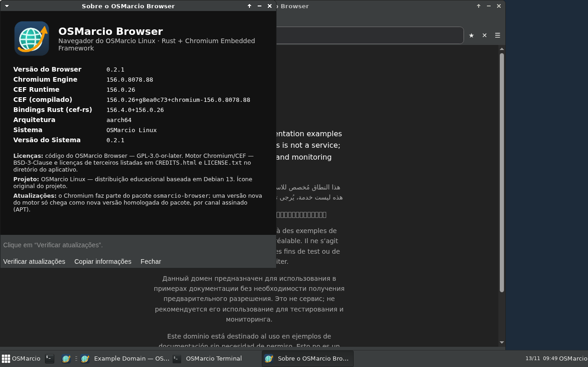
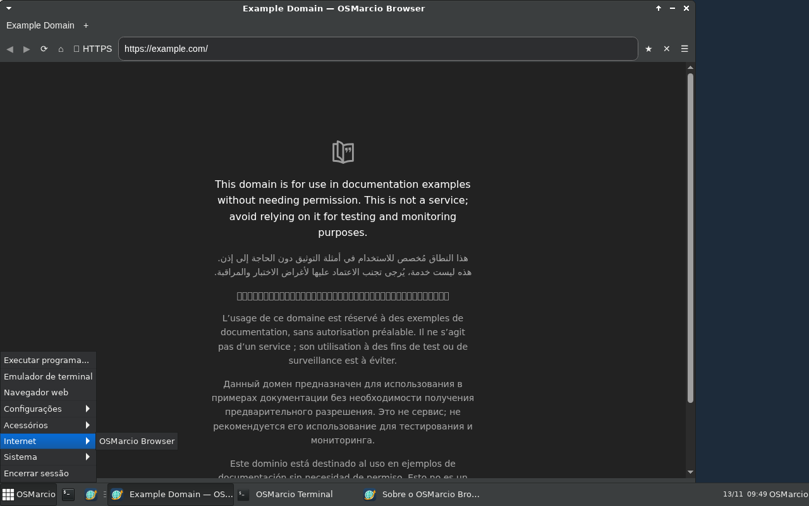
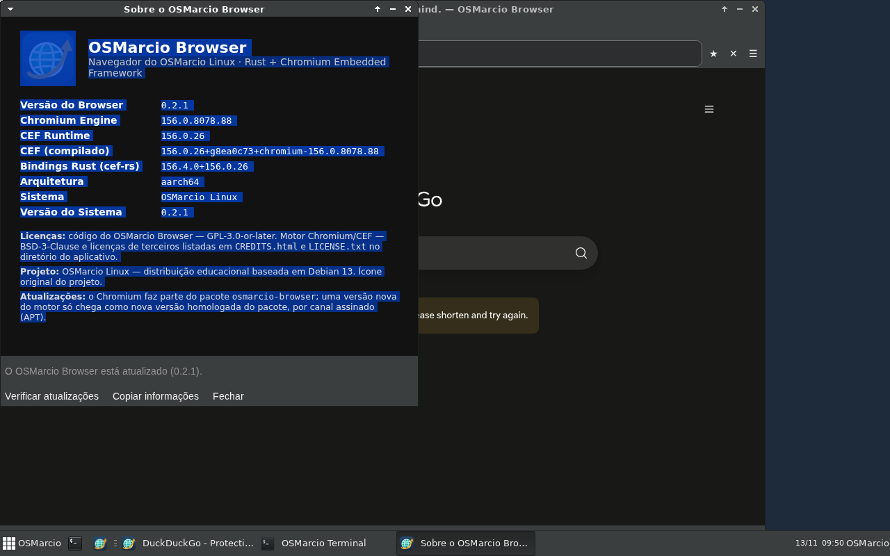

# Teste do hotfix do OSMarcio Browser — OSMarcioLinux-UTM-AArch64-Desktop-v0.2.1.img

- Data (UTC): 20261113T124648Z · Host: Darwin arm64, QEMU emulator version 11.0.1
- Sessão gráfica: login real no LightDM (ver `reports/tests/desktop-arm64-20261113T124648Z.md`)
- SHA-256 da imagem: `3d25df9333adfde917e381eec68feab534819fdec6f372134cbb6c0e08499e20`
- Resultado: **29 PASS, 3 FAIL**

```
PASS fechar-x-1-aba janela fechada, processo encerrado normalmente em 0s, 0 subprocessos
PASS tres-abas abertas
PASS fechar-altf4-3-abas janela fechada, processo encerrado normalmente em 0s, 0 subprocessos
PASS carregando página em carregamento (servidor lento)
PASS fechar-ctrlq-carregando janela fechada, processo encerrado normalmente em 1s, 0 subprocessos
PASS download iniciado (download_start path=/home/osmarcio/Downloads/grande.bin)
PASS fechar-x-download-ativo janela fechada, processo encerrado normalmente em 0s, 0 subprocessos
PASS menu aberto pelo botão ☰
PASS fechar-menu janela fechada, processo encerrado normalmente em 1s, 0 subprocessos
PASS ctrl-w fechou só a aba (janela continua aberta)
PASS fechar-ctrlw-ultima-aba janela fechada, processo encerrado normalmente em 1s, 0 subprocessos
RESULTADO(fechar): 11 passaram, 0 falharam
PASS reabrir navegador abriu e carregou de novo
LIMITACAO wm-class ausente (WM_CLASS:  not found.)
PASS icone-janela _NET_WM_ICON: Icon (16 x 16) Icon (128 x 128) 
PASS sobre-abrir browser=0.2.1 chromium=156.0.8078.88 cef=156.0.26 cef_compilado=156.0.26+g8ea0c73+chromium-156.0.8078.88 cef_rs=156.4.0+156.0.26 arch=aarch64 sistema=OSMarcio Linux 0.2.1 runtime_confere=true
PASS sobre-janela X11 27262987
PASS sobre-chromium igual ao --version (156.0.8078.88)
PASS sobre-runtime libcef.so carregado == versão compilada
RESULTADO(sobre-abrir): 6 passaram, 0 falharam
PASS sobre-verificar O OSMarcio Browser está atualizado (0.2.1).
FAIL sobre-verificar estado inesperado
PASS sobre-copiar texto copiado contém as versões (colado na barra de endereços)
RESULTADO(sobre-verificar): 2 passaram, 1 falharam
PASS sobre-fechar botão Fechar fechou só o Sobre; navegador segue aberto
PASS fechar-x-com-sobre-aberto janela fechada, processo encerrado normalmente em 0s, 0 subprocessos
RESULTADO(sobre-fechar): 2 passaram, 0 falharam
FAIL atualizacao-fonte-ausente: esperado /não configurada/, obtido: O OSMarcio Browser está atualizado (0.2.1).
PASS atualizacao-ja-atualizado: O OSMarcio Browser está atualizado (0.2.1).
PASS atualizacao-nova-homologada: Versão homologada 9.9.9 (Chromium 157.0.0.0) publicada, mas não há repositório APT assinado configurado para instalá-la com segurança.
PASS atualizacao-nao-homologada: Existe a versão 9.9.9, ainda não homologada para o OSMarcio Linux — não oferecida.
PASS atualizacao-incompativel: A versão 9.9.9 não tem pacote para esta arquitetura (arm64).
PASS atualizacao-http-recusado: Não foi possível verificar atualizações: manifest_url recusada (use https:// ou file:///): http://deb.debian.org/m.toml
PASS atualizacao-dns-falha: Não foi possível verificar atualizações: sem conexão (nome do servidor não resolvido)
PASS atualizacao-tls-falha: Não foi possível verificar atualizações: falha TLS/certificado — a fonte não foi aceita
PASS atualizacao-resposta-invalida: Não foi possível verificar atualizações: manifesto inválido: TOML parse error at line 1, column 11
FAIL atualizacao-sem-internet: esperado /sem conexão/, obtido: Não foi possível verificar atualizações: o servidor respondeu com erro HTTP
RESULTADO(atualizacoes): 8 passaram, 2 falharam
```

## Capturas de tela




