# Testes gráficos dos apps — OSMarcioLinux-UTM-AArch64-Desktop-v0.3.0.img

- Data (UTC): 20261113T140640Z · Host: Darwin arm64, QEMU emulator version 11.0.1
- Sessão gráfica: login real no LightDM (ver `reports/tests/desktop-arm64-20261113T140640Z.md`) · resolução 1280x800 · XFCE/xfwm4
- SHA-256 da imagem: `a3020e836f00df05dc4d4a05f710f1bd3f4b6b13e74c1047f759daa9725d0222`
- Resultado: **39 PASS, 12 FAIL**

```
PASS terminal-1-aba abriu
PASS terminal-ultima-aba sem botão X
PASS terminal-ultima-aba Ctrl+Shift+W não fecha a última aba
RESULTADO(terminal-1): 3 passaram, 0 falharam
PASS terminal-5-abas com botões X
RESULTADO(terminal-5): 1 passaram, 0 falharam
PASS terminal-10-abas (faixa rola, aba ativa visível)
RESULTADO(terminal-10): 1 passaram, 0 falharam
PASS terminal-fechamento individual 10→1 (em ordem qualquer), X some na última
PASS terminal-protecao última aba preservada
PASS terminal-maximizar 1280x763+0+0
PASS terminal-redimensionar 520x300+0+0
PASS terminal-fechar janela fechada
RESULTADO(terminal-fim): 5 passaram, 0 falharam
PASS browser-https example.com
PASS browser-acao-maximizar anunciada ao xfwm4
PASS browser-maximizar 1280x740+0+23 = área útil 1280x763 (painel preservado)
FAIL browser-cef sem evento de tamanho
RESULTADO(browser-max): 3 passaram, 1 falharam
FAIL browser-render faixa direita sem conteúdo (light=0.000 colors=1 pixels=88000)
PASS browser-restaurar 1100x760+1+24
PASS browser-abas nova aba carregou maximizada
PASS browser-tela-cheia F11 1280x800+0+0
PASS browser-tela-cheia sair volta a maximizada (independentes)
PASS browser-fechar encerrado sem órfãos
PASS browser-reabrir
RESULTADO(browser-fim): 6 passaram, 0 falharam
PASS files-abrir /home/osmarcio/osmf-teste
PASS files-listar 5 itens (oculto escondido)
PASS files-nova-pasta criada
PASS files-copiar a.txt → Destino (origem preservada)
PASS files-mover a.txt → Pasta Nova
FAIL files-renomear
PASS files-lixeira relatório.txt enviado à lixeira
FAIL files-restaurar
RESULTADO(files-a): 6 passaram, 2 falharam
FAIL files-cancelar tarefa ok: 1 item(ns) copiado(s)
PASS files-cancelar sem arquivo parcial no destino
RESULTADO(files-cancelar): 1 passaram, 1 falharam
RESULTADO(files-copia-inicio): 0 passaram, 0 falharam
PASS files-copia-grande concluída
FAIL files-copia-grande tamanho
RESULTADO(files-copia-fim): 1 passaram, 1 falharam
PASS files-permissao /root negada (usuário comum)
FAIL files-propriedades
RESULTADO(files-b): 1 passaram, 1 falharam
PASS files-busca 'grande' → 1 resultado
PASS files-ocultos Ctrl+H mostra .oculto (4→5)
FAIL files-abrir texto
PASS files-seguranca script.sh não executado
RESULTADO(files-icones): 3 passaram, 1 falharam
FAIL files-excluir-permanente
FAIL files não fechou
RESULTADO(files-fim): 0 passaram, 2 falharam
PASS minas-primeiro-clique (2,2) seguro com 16 minas em 25 casas
PASS minas-vitoria área 3×3 livre = vitória (personalizado 5×5/16)
RESULTADO(minas-vitoria): 2 passaram, 0 falharam
PASS minas-quantidade exatamente 10 minas (Fácil 9×9)
PASS minas-bandeira marcar (contador 9)
PASS minas-bandeira desmarcar (contador 10)
PASS minas-derrota mina em (1,5); temporizador parou em 3 s
RESULTADO(minas-derrota): 4 passaram, 0 falharam
PASS minas-reiniciar F2 novo jogo
FAIL minas-vitoria Fácil
FAIL minas-recorde
RESULTADO(minas-recorde): 1 passaram, 2 falharam
PASS minas-fechar janela
RESULTADO(minas-fim): 1 passaram, 0 falharam
```

## Capturas de tela
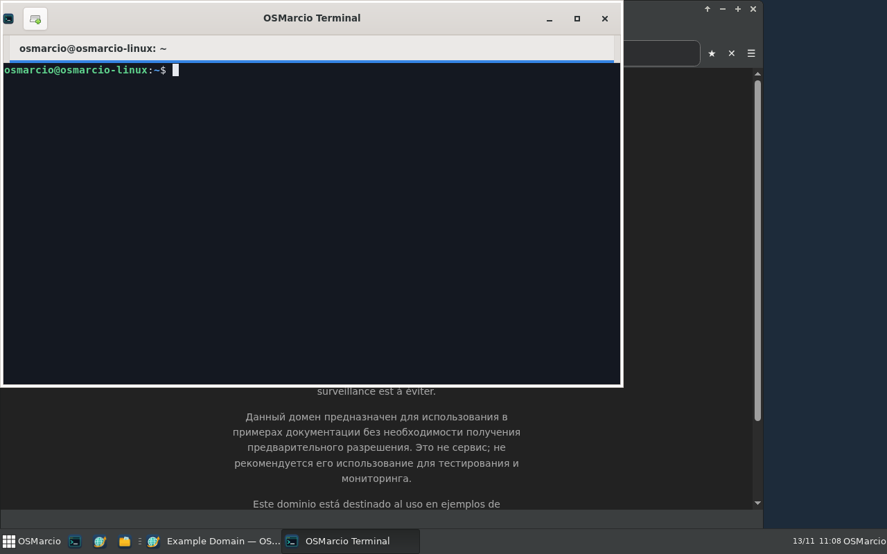
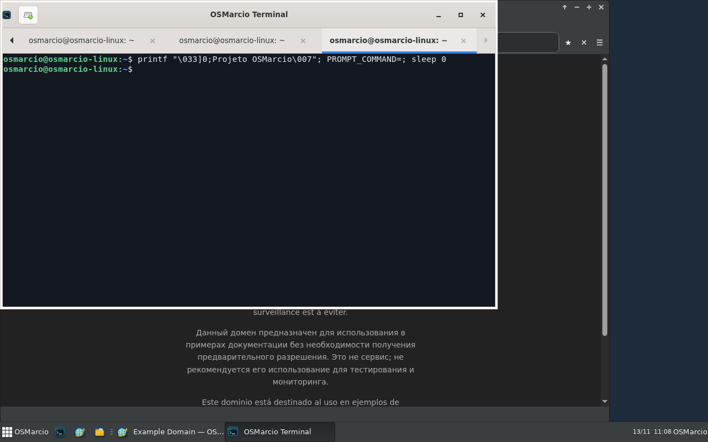
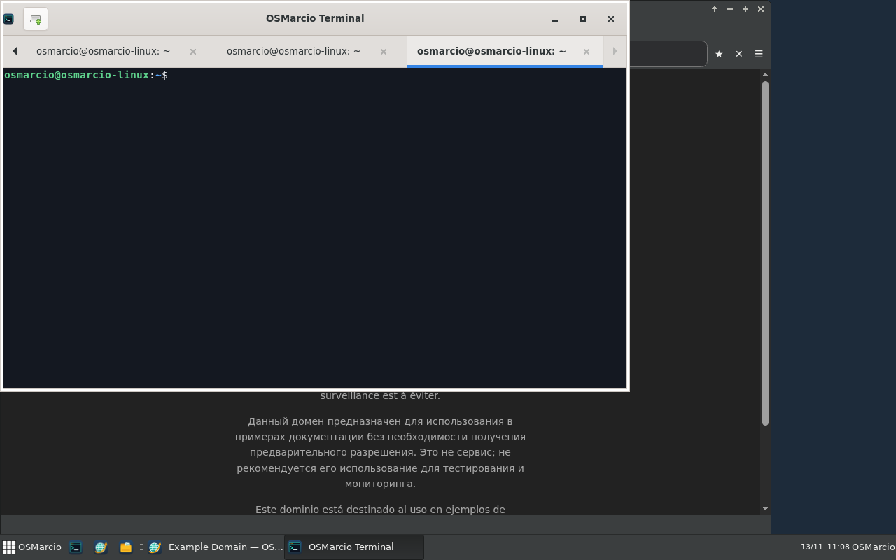
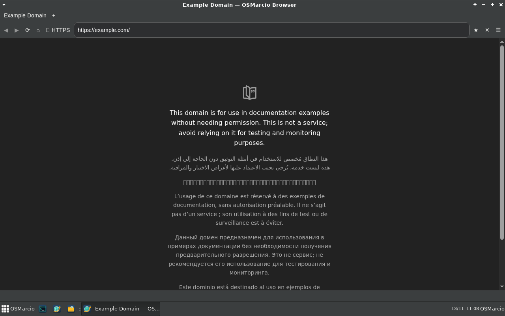
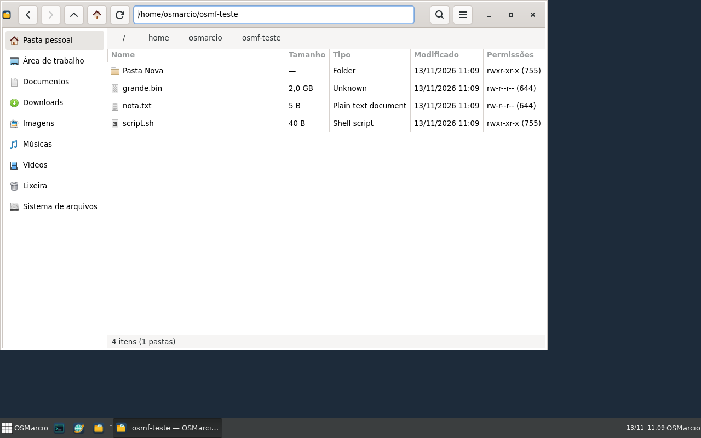
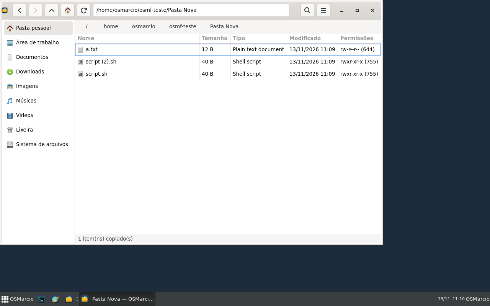
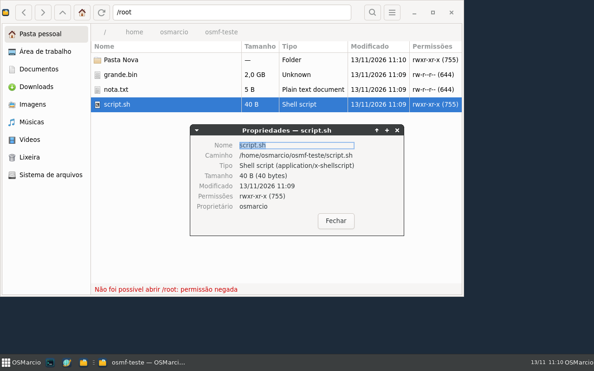
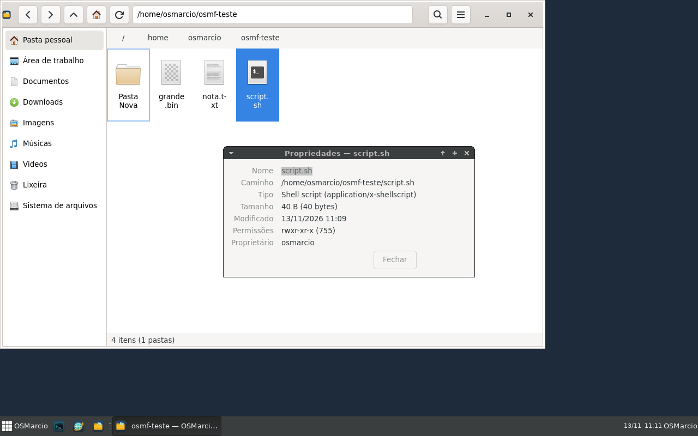
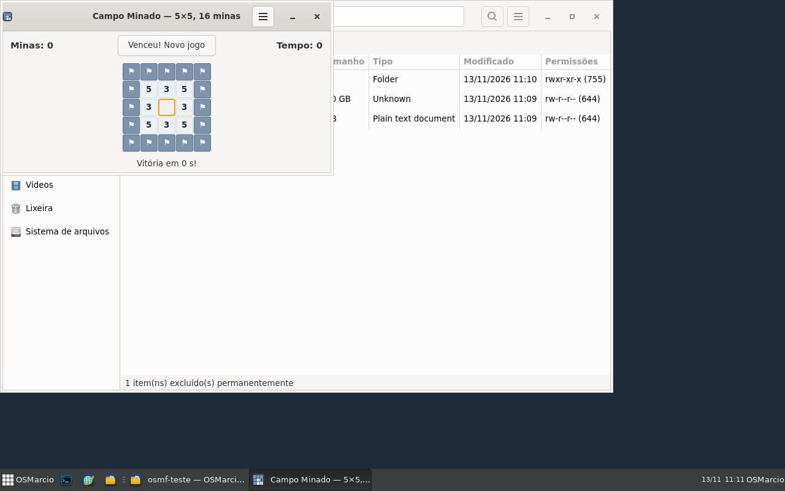
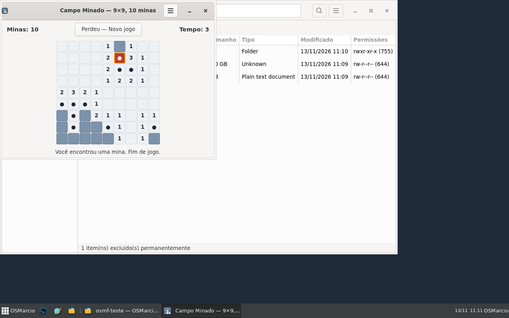
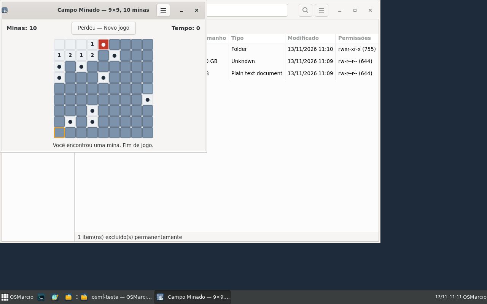
