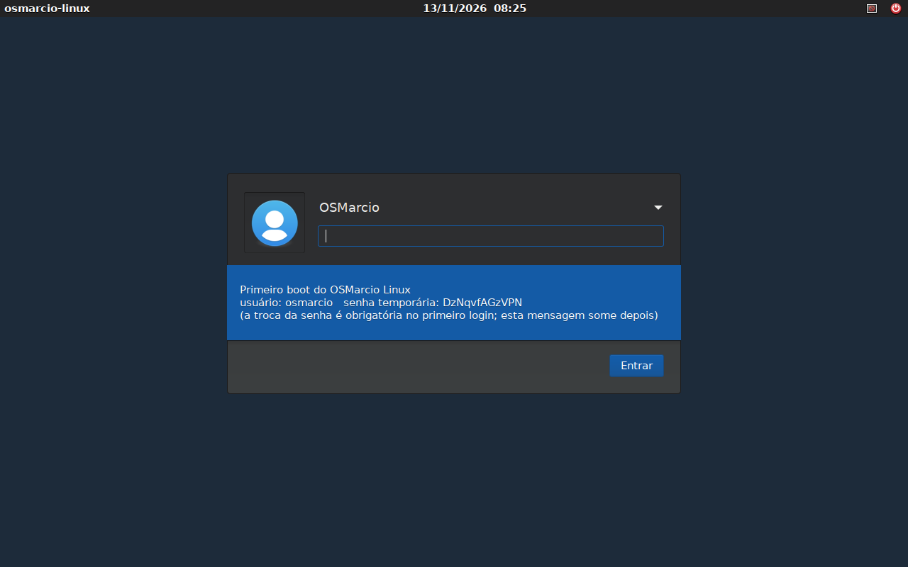
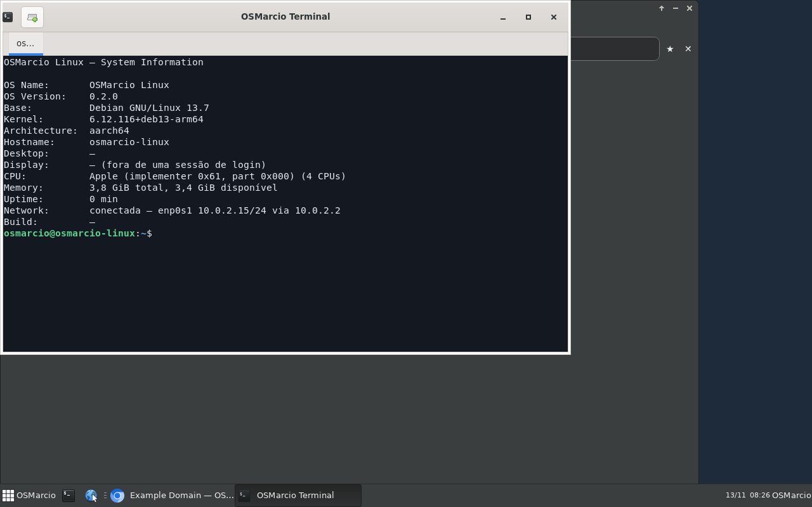

# Teste de desktop ARM64 — OSMarcioLinux-UTM-AArch64-Desktop-v0.2.0.img

- Data (UTC): 20261113T112503Z
- Host: Darwin arm64, QEMU emulator version 11.0.1
- Máquina: virt + HVF, UEFI edk2, virtio-gpu-pci, virtio-net, USB teclado/tablet, 4 GiB, 4 vCPUs
- SHA-256 da imagem: `9766374c76c0e0b640c00cbe4e03ab589c2827b5a57d65b13bffe331b6c24e40`
- Falhas: **0**

## Etapas observadas pelo host
- PASS firmware → GRUB → kernel → systemd → firstboot (senha temporária gerada)
- PASS LightDM + Xorg + greeter ativos
- PASS login gráfico com troca obrigatória de senha

## Autoteste interno (serial)
```
OSMTEST BEGIN mode=desktop
OSMTEST INFO boot-count=1
OSMTEST PASS kernel 6.12.116+deb13-arm64
OSMTEST PASS os-release 
OSMTEST PASS systemd-pid1 systemd
OSMTEST PASS root-ext4 ext4
OSMTEST PASS efi-mounted vfat
OSMTEST PASS user-exists uid=1000(osmarcio) gid=1000(osmarcio) grupos=1000(osmarcio),27(sudo)
OSMTEST PASS root-locked locked
OSMTEST PASS no-other-pw só osmarcio tem senha
OSMTEST PASS net-default-route default via 10.0.2.2 dev enp0s1 proto dhcp src 10.0.2.15 metric 1024 
OSMTEST PASS net-ipv4 enp0s1 10.0.2.15/24
OSMTEST PASS dns 2a04:4e42:3b::644 debian.map.fastlydns.net deb.debian.org
OSMTEST PASS https 200 0
OSMTEST PASS timesync yes
OSMTEST PASS apt-update Lendo listas de pacotes...
OSMTEST PASS apt-install Olá, mundo!
OSMTEST PASS apt-remove removed
OSMTEST PASS apt-signed 3 InRelease assinados verificados
OSMTEST PASS user-pw-temp senha temporária, troca obrigatória
OSMTEST PASS issue-notice 
OSMTEST PASS no-failed-units nenhuma
OSMTEST PASS rootfs-grown /dev/vda2        20G  1,7G   17G  10% /
OSMTEST PASS grub-symlink boot/vmlinuz-6.12.116+deb13-arm64
OSMTEST INFO mem-used-MiB=346 mem-total-MiB=3913
OSMTEST INFO root-used=1,7G procs=138
OSMTEST INFO uptime-at-selftest-end-s=4.45 userspace-units=104
OSMTEST PASS default-target graphical.target
OSMTEST PASS display-manager lightdm + Xorg + greeter ativos
OSMTEST PASS xorg-driver [     2.242] (II) modeset(0): glamor initialization failed
OSMTEST PASS app-terminal ARM aarch64
OSMTEST PASS app-info Distribuição:  OSMarcio Linux 0.2.0 (base Debian 13 trixie)
OSMTEST PASS app-browser-arch osmarcio-browser + libcef.so: ARM aarch64
OSMTEST PASS app-browser-libs nenhuma biblioteca ausente
OSMTEST PASS userns-sandbox user namespaces sem privilégio habilitados
OSMTEST END
OSMTEST BEGIN-DESKTOP
OSMTEST PASS desktop-session xfce4-session pid=1031 DISPLAY=:0 tipo=x11
OSMTEST PASS desktop-xfwm4 em execução
OSMTEST PASS desktop-xfce4-panel em execução
OSMTEST PASS desktop-xfdesktop em execução
OSMTEST PASS desktop-resolution 1280x800 (Virtual-1)
OSMTEST PASS terminal-window janela X11 25165828 (OSMarcio Terminal)
OSMTEST PASS terminal-shell bash executou comando digitado: 'OSMTERM-42 osmarcio /bin/bash'
OSMTEST PASS browser-init OSMarcio Browser 0.2.0 (CEF 156.0.26+g8ea0c73+chromium-156.0.8078.88)
OSMTEST PASS browser-window janela X11 27262978
OSMTEST PASS browser-https example.com status 200
OSMTEST PASS browser-sandbox renderer pid=1349 seccomp=2 pidns-aninhado
OSMTEST PASS browser-no-sandbox nenhum processo com --no-sandbox
OSMTEST INFO browser-rss-MiB=738 mem-used-MiB=587
OSMTEST END-DESKTOP
```

## Capturas de tela


